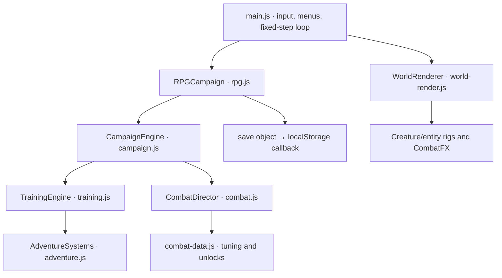

# Architecture

[moss-layout.js](../src/moss-layout.js) adds the first gate’s connected landing networks after the base room registry is assembled. The layouts use the existing platform physics; room metadata describes their routes for rendering and validation. Ground passages, room identifiers, and progression gates retain their existing contracts.

[Documentation index](README.md) · [Project README](../README.md)

## Runtime and build

The game is a static Canvas2D application written in JavaScript ES modules with plain HTML and CSS. esbuild bundles src/main.js and its imports into a checked-in classic IIFE script, bundle/game.js. index.html loads that deferred script, supporting direct-file use and hosting under a repository subpath without module fetches. Fonts and icons are local.

Node provides development, build, verification, and a simple static HTTP server. There is no gameplay backend, account service, database, or runtime package dependency. Playwright is a development dependency for Chromium integration.

## Engine layers

AdventureSystems owns party resources, healing, signature skills, statuses, and the original minions. TrainingEngine supplies the shared motion, collision, strike, and projectile kernel; its old six-chamber training route remains an isolated regression fixture, not a selectable game mode. CampaignEngine replaces those lesson gates with rooms, guardians, traversal, interaction, crafting, and persistent progression. RPGCampaign adds quests, gear, talents, covenants, mastery, events, optional bosses, and save migration.

CombatDirector is composed into CampaignEngine rather than another inheritance layer. It owns attack states, buffered routes, cancels, Guard/parry, Flow, posture, juggling, and equipped arts. It calls the host engine’s strike/reward path so RPG modifiers and quest attribution remain intact. The eight starter signatures and fields are implemented in companion-kits.js; rescued companions retain their legacy signatures. Signature reuse belongs to each companion and persists through saves; fields retain the casting owner across switches.

## Simulation and presentation

main.js advances gameplay at a fixed 60 Hz using a requestAnimationFrame accumulator, with bounded catch-up steps. Gameplay frames determine attacks, timers, and collision. Hitstop preserves combat windows. Rendering has separate ambient and actor clocks: ambient scenery can keep moving, while player and enemy rig animation stops during pause, hitstop, and non-playing states. Attack progress comes from the simulation rather than either visual clock. Effects cannot generate damage.

Positions are world pixels with positive Y downward. Player and enemy positions refer to their feet; common ground is Y = 520. The actor has one world transform across party swaps, while health, Focus, and signature cooldowns belong to the selected party member. Shared Guard, movement expenditure, and art cooldowns prevent swap-refresh exploits.

WorldRenderer follows the player with a camera, then draws biome layers, enclosed cave backwalls/ceilings, geometry, recovery basins, room objects, entities, actor, projectiles, hazards, and effects. CombatFX uses bounded pools and seconds-based visual lifetimes. Its camera zoom is an **absolute multiplier**: 1 is neutral. Reduced motion disables camera impulses, suppresses afterimages, and softens secondary motion while preserving readable silhouettes and attack cues.

Renderers receive presentation copies of enemies rather than adding animation fields to simulation objects. A renderer-local history and corpse cache completes death animation for enemies removed immediately by gameplay. Those visual bodies cannot collide, delay rewards, keep enemies alive, or enter a save. Room changes clear the caches. Entity wrappers preserve Canvas context state and apply whole-body action/recoil effects around the species-specific art.

Menus and explicitly requested ending choices use the shared overlay dialog. Guardian rewards are committed immediately and announced through the HUD; boss defeat does not open a reward dialog. NPC conversations use a separate nonmodal DOM layer anchored to the speaker in the game scene. The entry cinematic has a separate presentation dialog, and the portrait rotation prompt remains the outer interaction gate. Opening a gameplay overlay pauses the simulation and clears held inputs. Blur and tab hiding also pause through the UI. window.kinetic exposes a defensive snapshot and version for inspection, not a mutable game object or a cheat API.

## Source map

| File | Responsibility |
| --- | --- |
| [src/rpg.js](../src/rpg.js) | RPG quests, equipment, talents, factions, mastery, world events, v2/v3/v4 save migration |
| [src/companion-kits.js](../src/companion-kits.js) | Eight starter stat profiles, 40 directional techniques, transient fields, cross-party combinations |
| [src/companion-render.js](../src/companion-render.js) | Read-only signature fields, directional flourishes and casting effects |
| [src/minion-species.js](../src/minion-species.js), [src/minion-behavior.js](../src/minion-behavior.js) | Twelve biome species with committed attacks, guards, medic channels, and counterplay |
| [src/room-identity.js](../src/room-identity.js), [src/room-identity-render.js](../src/room-identity-render.js) | 42 authored identities, gallery routes, progressive passage size/ecology, and world landmarks |
| [src/boss-overdrive-moves.js](../src/boss-overdrive-moves.js) | Two extra signature moves per boss, armament and shield events, and fourth-phase sequences |
| [src/combat.js](../src/combat.js) | Frame-driven attack controller, movement cancels, Guard/parry, juggle/posture, powers |
| [src/combat-data.js](../src/combat-data.js) | Move frame data, movement tuning, twelve art definitions and unlock rules |
| [src/combat-fx.js](../src/combat-fx.js) | Capped particles, biome ambience, elemental impacts, camera and screen feedback |
| [src/entity-animation.js](../src/entity-animation.js) | Boss/minion action, recoil/death, telegraphs and NPC interaction animation |
| [src/combat-ui.js](../src/combat-ui.js), [src/combat-style.css](../src/combat-style.css) | Responsive Arsenal, move manual, power loadout and combat HUD |
| [src/chronicle.js](../src/chronicle.js) | Eight optional story arcs, covenants, new rooms/bosses/entities, ten history records |
| [src/rpg-data.js](../src/rpg-data.js) | Talent trees, equipment modifiers, item rarities, merchant stock, bond ranks |
| [src/rpg-ui.js](../src/rpg-ui.js) | Quest journal, talent constellation, reliquary, soul bonds, history, covenants, merchant |
| [src/chronicle-art.js](../src/chronicle-art.js) | Chronicle world-event art and legacy entity fallback |
| [src/rpg-render.js](../src/rpg-render.js) | New NPC rigs, room landmarks, mastery auras, loot and the familiar |
| [src/rpg-world.js](../src/rpg-world.js) | Additive campaign registry integration with stable original save identifiers |
| [src/world.js](../src/world.js) | Campaign graph, geometry, biomes, story, guardians, items, charms, ability rewards |
| [src/campaign.js](../src/campaign.js) | Room state, progression, saves, fast combat, tools, crafting, recruitment, guardian AI |
| [src/training.js](../src/training.js) | Shared locomotion/collision implementation and isolated regression fixture |
| [src/adventure.js](../src/adventure.js) | Independent party resources, healing, original skills, statuses, minion AI |
| [src/designs.js](../src/designs.js) | Supplied creature identities, new companions, wild species |
| [src/creatures.js](../src/creatures.js) | Compatible companion-drawing re-export and legacy minion fallback rigs |
| [src/creature-art.js](../src/creature-art.js) | Eleven companion silhouettes, articulated action poses, materials and portrait bounds |
| [src/enemy-art.js](../src/enemy-art.js) | Thirty-one species-specific wild enemy rigs and state animation |
| [src/boss-art.js](../src/boss-art.js) | Twenty-one main, forbidden and miniboss rigs, phase details and final-guardian variants |
| [src/dungeon-art.js](../src/dungeon-art.js) | Dungeon attack telegraphs and legacy enemy fallback art |
| [src/boss-encounters.js](../src/boss-encounters.js) | Boss profile registry, fixed-frame timelines, encounter hazards, summons and temporary terrain |
| [src/boss-progression.js](../src/boss-progression.js) | Encounter progression tiers, separate movement/attack tempo tuning, late-game desperation rules |
| [src/boss-aftermath.js](../src/boss-aftermath.js) | Nine guardian remains, copied lore data, and interactions derived from live defeat state |
| [src/boss-aftermath-render.js](../src/boss-aftermath-render.js) | Pure guardian transformations, lesser-champion weapon destruction, and settled world landmarks |
| [src/boss-major-moves.js](../src/boss-major-moves.js) | Nine major/forbidden guardian move sets and phase sequences |
| [src/boss-warden-moves.js](../src/boss-warden-moves.js) | Six distinct dimensional gatekeeper move sets |
| [src/boss-reaver-moves.js](../src/boss-reaver-moves.js) | Six distinct optional vault encounter move sets |
| [src/boss-encounter-render.js](../src/boss-encounter-render.js) | Encounter hazard, warning, weapon and temporary-platform presentation |
| [src/world-render.js](../src/world-render.js) | Scene composition, art routing, actor clock, local death visuals, effects and camera |
| [src/tunnel-render.js](../src/tunnel-render.js) | Enclosed cave layers, geological shelves, lighting, camps and recovery basins |
| [src/mourningwild-render.js](../src/mourningwild-render.js) | Dedicated sanctuary/first-gate backdrops, landmarks, landing surfaces and foreground layers |
| [src/opening-cinematic.js](../src/opening-cinematic.js), [src/intro.css](../src/intro.css) | Pure three-act opening timeline, chosen-party Canvas compositions and cinematic dialog layout |
| [src/boss-cinematic.js](../src/boss-cinematic.js) | Pure physical guardian entrances and choice-aware ending compositions and captions |
| [src/landing.js](../src/landing.js), [src/landing.css](../src/landing.css) | Viewport-fitting title screen, dynamic panels and realm previews |
| [src/world-dialogue-state.js](../src/world-dialogue-state.js) | Presentation-only conversation pages, proximity, ambient timing, and session voice history |
| [src/world-dialogue.js](../src/world-dialogue.js), [src/world-dialogue.css](../src/world-dialogue.css) | Accessible floating scene speech, speaker labels, touch controls, and viewport placement |
| [src/world-voices.js](../src/world-voices.js) | Authored landmark whispers for every room and distinct boss introduction/defeat lines |
| [src/recovery.js](../src/recovery.js) | Seeded spring layout, world-seed validation, safe respawn-point validation |
| [src/main.js](../src/main.js) | Campaign UI, dialogs, atlas, inventory, keyboard/touch controls, fixed-step loop |
| [src/render.js](../src/render.js) | Shared canvas sizing and portraits |
| [src/style.css](../src/style.css) | Responsive interface and locally bundled fonts |

| Tooling / entry | Responsibility |
| --- | --- |
| [src/mobile.css](../src/mobile.css) | Landscape thumb controls, rotation prompt and priority menu |
| [index.html](../index.html) | Home, Canvas, HUD, touch controls, shared dialog |
| [server.mjs](../server.mjs) | Static HTTP serving and local MIME types |
| [scripts/build.mjs](../scripts/build.mjs) | esbuild bundle, watch mode, bundle comparison |
| [scripts/check.mjs](../scripts/check.mjs) | Syntax checks and generated-bundle freshness |
| [tests/](../tests/) | Simulation tests, route controllers, Chromium suites |

## Mobile layout ownership

main.js detects coarse-pointer devices and compact viewports, activates the mobile-game layout, and blocks portrait orientation on home, menus, and gameplay. Active gameplay pauses in portrait. The rotate prompt makes the home screen, game, and any existing modal inert; returning to landscape restores the previous modal pause state. Resize transitions clear held actions. Fullscreen/orientation locking is attempted only from the explicit landscape button; manual rotation remains the fallback. src/mobile.css lays out larger combat/movement targets and the priority menu. The viewport remains unrotated so input coordinates, dialogs, and screen readers share the same coordinate space.

## Landing and arrival presentation

The title screen is one viewport, with its main controls and secondary panels composed inside that frame. Its layout rules are scoped away from active gameplay; preparation and world details use the existing dialogs. `landing.js` owns title-screen interaction, while `main.js` owns campaign start/resume and the opening lifecycle.

The opening renderer accepts elapsed presentation time and party IDs. Its three scenes do not run gameplay, award progression, change collision, or write saves. New expeditions play it before control returns to the Last Lantern. Continue bypasses it; title-screen replay returns to the title screen without replacing a save. Input clearing and focus restoration belong to the host UI. Its 12-second elapsed clock advances only while the opening is visible, focused, and allowed by the orientation gate; it resumes from the same elapsed point after a pause. The gameplay accumulator stays empty until the opening finishes or is skipped, so there is no simulation catch-up behind it. Reduced motion keeps a static composition within each story act while retaining scene changes and captions.

The sanctuary and first gate use dedicated scenery passes in `mourningwild-render.js`. Backdrops are screen-space; landmarks, attached platform art, and restrained foreground detail use world space and the scrolling camera. These passes replace overlapping generic cave decoration for handled rooms. Scenery is presentation-only: persistent room IDs, terrain collision, catch landings, boss encounters, and sparse recovery rules remain authoritative in the existing data and simulation.

Guardian introductions and ending scenes use the pure `boss-cinematic.js` renderer. `main.js` owns their elapsed time, caption updates, focus, skip input, and return destination. Combat remains paused and the fixed-step accumulator stays empty throughout. The cinematic clock stops in portrait, on window blur, and in hidden tabs. Reduced motion holds complete scene compositions within each story act.

The nine essential introductions are remembered in an ephemeral set for the current loaded expedition. A retry in that session bypasses an already seen introduction; a new expedition, Continue, or page reload reconstructs presentation state. No cinematic flags are added to a save. The Hollow Sovereign’s defeat exposes an E-interactable Worldheart; interacting opens the main ending choice and then its finale and credits. The Nullheart’s remains request the covenant finale and summary through E. Continue resumes exploration after either ending without replaying its transaction or reopening a completed summary. An unfinished Worldheart choice remains available at the in-world object.

## Guardian aftermaths

`boss-aftermath.js` derives interaction objects from the current room and authoritative enemy defeat state. `CampaignEngine.bossAftermath` exposes the room’s guardian remains, and `interactionObjects` combines them with authored room objects without modifying the shared room registry. Living bosses restored by a gate death suppress their old remains. Defeat events include copied boss/room/feet metadata for presentation. Interactive landmarks use the authored room spawn as a stable, reachable anchor; reloading reconstructs the settled landmark from existing defeat records. No aftermath or elapsed-animation fields enter the save.

`boss-aftermath-render.js` accepts a copied record and elapsed presentation time. Its transformations cannot collide, delay unlocks, or retain a dead gameplay enemy. The host renderer owns local elapsed time and draws the settled form after reload; reduced motion uses that form immediately. E reads ordinary aftermath lore through scene dialogue. The Worldheart and Nullheart interactions emit explicit ending requests handled by the UI, so defeating a boss does not interrupt exploration with a reward or ending window.

## Voices in the world

`CampaignEngine.showDialogue(lines, source)` emits copied speaker/text pairs with the source room, object ID, position, name, and kind. NPC interactions pass their real room object, including Vell’s first greeting and the optional chronicle conversations. Dialogue presentation never owns quest completion or reward claims.

`WorldDialogueState` owns transient conversation pages and ambient voice timing. The host projects world anchors through the camera, then places the `world-dialogue` DOM layer beside the speaker. Text updates use a polite live region; positioning does not rewrite or reannounce the line every frame. Long lines split at sentence or word boundaries into readable pages. E/Enter and touch controls advance manual conversations; movement, jumping, party switching, and combat remain available. Walking beyond conversational range or changing rooms ends the voice. Gameplay overlays and the portrait gate hide the layer and suspend its clock until play resumes.

`world-voices.js` adds short whispers at existing landmarks in all rooms and distinct introduction/defeat lines for each boss. Landmark whispers wait for nearby quiet space and play once per running expedition session; they do not consume E, collect an inscription, award a memory, or write a save. Boss voices follow the actual encounter anchor. Home, a new expedition, and game over clear transient speech. Existing saved quest and memory records remain authoritative; voices are not serialized.

## Data registration and extension boundaries

world.js defines the main registries. chronicle.js remains pure optional-story data; importing rpg-world.js merges optional rooms, enemies, bosses, links, and dialogue into the main registries. Import the RPG entry when inspecting the complete live world; world.js alone contains only the base campaign.

Persistent identifiers belong to content definitions and must remain stable across releases. Keep render code free of save mutations and collision logic. Use engine events for effects and notifications. Update data, gameplay behavior, art, menu descriptions, and meaningful tests together when adding a mechanic. See [content authoring](content-authoring.md) and [save format](save-format.md).

## Procedural art pipeline

The current companion, wild-enemy, and boss artwork shares dark contours, curved organic forms, faceted material highlights, and restrained elemental light. Each identity has its own anatomy and articulated parts; the supplied creature concepts remain the reference in [creature designs](creature-designs.md). Companion posing distinguishes locomotion, airborne motion, dash, defense, attacks, casting, and recoil. Boss materials and secondary elements respond to encounter phase; final-guardian artwork also receives the resolved faction variant.

World art is anchored at the actor’s feet in world coordinates. Facing and drawing scale belong to the drawing call, not the collision body. `creatureBounds` describes each companion’s full local silhouette; portraits fit those padded bounds with one uniform scale. Hero portraits refresh visible idle animation at 10 Hz and freeze with reduced motion. Art bounds never define attack reach or hurtboxes. The public creature entry point remains compatible with existing callers. See [animation authoring](content-authoring.md#animation-and-accessibility) for the rendering contracts.

## Boss encounter timelines

The 21 boss identities each resolve to a profile with six named moves and four phase sequences. The profile modules describe movement preference, readable counterplay, startup, active duration, recovery, and event builders. The runtime combines those authored patterns with distance, recent-move history, and player pressure when selecting an attack. It owns locked targets, movement scripts, defensive responses, and actual hazard collision. Sharing event primitives does not share a move set: encounters combine them into different spatial and timing problems.

Encounter zones use world coordinates and centered bounds. Warning delay precedes damage; active geometry is also the geometry the renderer displays. Temporary platforms enter the normal collision list as one-way landings. Summoned minions carry an encounter owner and do not pass through ordinary reward/progression payouts. Phase changes, defeat, room changes, and death clear encounter-owned state. Shared room definitions and authored floors are never rewritten by an arena attack.

Boss move state, pressure history, defensive responses, healing attempts, hazard lifetimes, and temporary terrain are transient simulation state. They pause with gameplay and hitstop; renderer clocks do not advance attacks. Loading an existing save reconstructs the encounter from its room and persistent defeat/reward state. Progression scaling is defined separately from move geometry and does not follow player level; late desperation is separate from the three authored phase indices. See [boss encounter reference](boss-encounters.md) and [content authoring](content-authoring.md#add-a-boss) for profile and event contracts.

## Dimensional dungeon expansion

[dimensions.js](../src/dimensions.js) defines 24 branching dungeon rooms and six buried stories. world.js registers these alongside existing rooms and preserves their saved IDs. [dungeon-enemies.js](../src/dungeon-enemies.js) defines twelve minibosses; [difficulty.js](../src/difficulty.js) supplies health/phase rules, four dungeon minion AIs, and the campaign healing contract. Boss behavior routes through the individual profiles and fixed-frame encounter runtime in [boss-encounters.js](../src/boss-encounters.js).

Door objects may specify destination `spawn: {x, y}` and a `requiresBoss` seal. Enemy spawns may specify `y`, `left`, `right`, and `introX` for elevated patrols. Room `map: {x,y}`, `depth`, and `dungeon` metadata drive the atlas. Feet coordinates remain positive downward, with upper floors using negative Y. The renderer follows vertical climbs. safeRest is distinct from the local fall checkpoint and is validated against a real spring in the saved worldSeed’s layout when loading.

## Recovery and Game Over state

CampaignEngine owns the expedition seed, automatic spring-entry detection, current spring usage, gate-wide enemy resurrection, and pending death. The layout stays outside shared room objects: recoveryForRoom derives its used flags from each journey’s spentRecovery set. Entering a spring restores the party and binds safeRest; camps and fast travel do not heal. Camps, workbenches, and nearby springs share the atBench service predicate for crafting, upgrades, and companion changes. The sanctuary hearth can activate again after the player leaves and returns.

On a full wipe, beginGameOver finalizes the Lumen penalty and gate enemy reset before saving and emitting gameover. Current defeated state is separate from lifetime claimedEnemyRewards, preserving unique progression while allowing enemies to live again. The engine remains in phase gameover until retryAfterDeath restores the party and loads the last validated spring. main.js presents a non-dismissible Game Over modal with Retry and Save & Title; rotation overlays preserve that pending decision. Returning to the title or reloading cannot dismiss death or apply its penalty twice.

## Grounded passage geometry

The mandatory dungeon route now uses continuous Y = 520 floors and ground-level passage exits. Upper ledges keep their coordinates for optional history, loot, and shortcuts; wider landing surfaces and `catch: true` shelves reduce pit deaths. The first seeded spring in each gate keeps its existing identifier but sits on the lower passage. This is a room-data and presentation change: the shared movement kernel, combat damage, and death transaction remain unchanged.

## Party and room identity contracts

The eight starter profiles separate health, strike damage, running speed, takeoff velocity, gravity, Focus cost, and signature reuse. COMPANION_KITS is the authoritative source; generated UI reads the same names and tips. Horizontal signature inputs aim toward or away from the nearest live threat, so retreat works after several walking frames. Companion fields advance in the simulation, retain their owner after switching, and clear on room/death boundaries. Drawing those fields cannot apply hits.

The room registry applies explicit room identities during registration, after the first-gate landing network and after optional Chronicle room registration. Existing save identifiers and enemy indices remain stable; added ecology spawns append. Main floors remain continuous. Door destinations and arrival ledges follow actual authored objects, not historical hardcoded exit coordinates.

Renderer-local defeat clocks display essential transformations for 4800ms and lesser-champion weapon destruction for 2600ms. They use actual impact coordinates before moving material toward stable remains. Pause and hitstop stop those clocks. Rewards commit immediately, with no modal; reloading a cleared room draws settled major remains. E-driven lore and finale decisions use interactionObjects without modifying shared room.objects.
