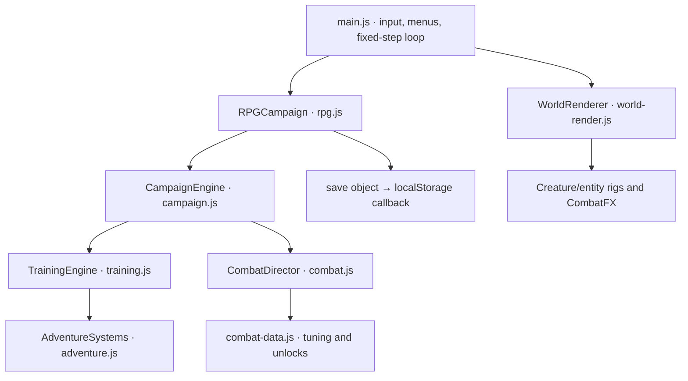

# Architecture

[moss-layout.js](../src/moss-layout.js) adds the first gate’s connected landing networks after the base room registry is assembled. The layouts use the existing platform physics; room metadata describes their routes for rendering and validation. Ground passages, room identifiers, and progression gates retain their existing contracts.

[Documentation index](README.md) · [Project README](../README.md)

## Runtime and build

The game is a static Canvas2D application written in JavaScript ES modules with plain HTML and CSS. esbuild bundles src/main.js and its imports into a checked-in classic IIFE script, bundle/game.js. index.html loads that deferred script, supporting direct-file use and hosting under a repository subpath without module fetches. Fonts and icons are local.

Node provides development, build, verification, and a simple static HTTP server. There is no gameplay backend, account service, database, or runtime package dependency. Playwright is a development dependency for Chromium integration.

## Engine layers

AdventureSystems owns party resources, healing, signature skills, statuses, and the original minions. TrainingEngine supplies the shared motion, collision, strike, and projectile kernel; its old six-chamber training route remains an isolated regression fixture, not a selectable game mode. CampaignEngine replaces those lesson gates with rooms, guardians, traversal, interaction, crafting, and persistent progression. RPGCampaign adds quests, gear, talents, covenants, mastery, events, optional bosses, and save migration.

CombatDirector is composed into CampaignEngine rather than another inheritance layer. It owns attack states, buffered routes, cancels, Guard/parry, Flow, posture, juggling, and equipped arts. It calls the host engine’s strike/reward path so RPG modifiers and quest attribution remain intact. Party signatures remain in the shared/campaign skill implementations.

## Simulation and presentation

main.js advances gameplay at a fixed 60 Hz using a requestAnimationFrame accumulator, with bounded catch-up steps. Gameplay frames determine attacks, timers, and collision. Hitstop preserves combat windows. Rendering has separate ambient and actor clocks: ambient scenery can keep moving, while player and enemy rig animation stops during pause, hitstop, and non-playing states. Attack progress comes from the simulation rather than either visual clock. Effects cannot generate damage.

Positions are world pixels with positive Y downward. Player and enemy positions refer to their feet; common ground is Y = 520. The actor has one world transform across party swaps, while health, Focus, and signature cooldowns belong to the selected party member. Shared Guard, movement expenditure, and art cooldowns prevent swap-refresh exploits.

WorldRenderer follows the player with a camera, then draws biome layers, enclosed cave backwalls/ceilings, geometry, recovery basins, room objects, entities, actor, projectiles, hazards, and effects. CombatFX uses bounded pools and seconds-based visual lifetimes. Its camera zoom is an **absolute multiplier**: 1 is neutral. Reduced motion disables camera impulses, suppresses afterimages, and softens secondary motion while preserving readable silhouettes and attack cues.

Renderers receive presentation copies of enemies rather than adding animation fields to simulation objects. A renderer-local history and corpse cache completes death animation for enemies removed immediately by gameplay. Those visual bodies cannot collide, delay rewards, keep enemies alive, or enter a save. Room changes clear the caches. Entity wrappers preserve Canvas context state and apply whole-body action/recoil effects around the species-specific art.

The UI uses one dialog for menus, dialogue, rewards, and endings. Opening it pauses gameplay and clears held inputs. Blur and tab hiding also pause through the UI. window.kinetic exposes a defensive snapshot and version for inspection, not a mutable game object or a cheat API.

## Source map

| File | Responsibility |
| --- | --- |
| [src/rpg.js](../src/rpg.js) | RPG quests, equipment, talents, factions, mastery, world events, v2/v3/v4 save migration |
| [src/combat.js](../src/combat.js) | Frame-driven attack controller, movement cancels, Guard/parry, juggle/posture, powers |
| [src/combat-data.js](../src/combat-data.js) | Move frame data, movement tuning, twelve art definitions and unlock rules |
| [src/combat-fx.js](../src/combat-fx.js) | Capped particles, biome ambience, elemental impacts, camera and screen feedback |
| [src/entity-animation.js](../src/entity-animation.js) | Boss/minion action, recoil/death, telegraphs and NPC interaction animation |
| [src/combat-ui.js](../src/combat-ui.js), [src/combat-style.css](../src/combat-style.css) | Responsive Arsenal, move manual, power loadout and combat HUD |
| [src/chronicle.js](../src/chronicle.js) | Eight optional story arcs, covenants, new rooms/bosses/entities, ten history records |
| [src/rpg-data.js](../src/rpg-data.js) | Talent trees, equipment modifiers, item rarities, merchant stock, bond ranks |
| [src/rpg-ui.js](../src/rpg-ui.js) | Quest journal, talent constellation, reliquary, soul bonds, history, covenants, merchant |
| [src/chronicle-art.js](../src/chronicle-art.js) | Chronicle world-event art and legacy entity fallback |
| [src/rpg-render.js](../src/rpg-render.js) | New NPC rigs, room landmarks, mastery auras, loot and the familiar |
| [src/rpg-world.js](../src/rpg-world.js) | Additive campaign registry integration with stable original save identifiers |
| [src/world.js](../src/world.js) | Campaign graph, geometry, biomes, story, guardians, items, charms, ability rewards |
| [src/campaign.js](../src/campaign.js) | Room state, progression, saves, fast combat, tools, crafting, recruitment, guardian AI |
| [src/training.js](../src/training.js) | Shared locomotion/collision implementation and isolated regression fixture |
| [src/adventure.js](../src/adventure.js) | Independent party resources, healing, original skills, statuses, minion AI |
| [src/designs.js](../src/designs.js) | Supplied creature identities, new companions, wild species |
| [src/creatures.js](../src/creatures.js) | Compatible companion-drawing re-export and legacy minion fallback rigs |
| [src/creature-art.js](../src/creature-art.js) | Eleven companion silhouettes, articulated action poses, materials and portrait bounds |
| [src/enemy-art.js](../src/enemy-art.js) | Nineteen species-specific wild enemy rigs and state animation |
| [src/boss-art.js](../src/boss-art.js) | Twenty-one main, forbidden and miniboss rigs, phase details and final-guardian variants |
| [src/dungeon-art.js](../src/dungeon-art.js) | Dungeon attack telegraphs and legacy enemy fallback art |
| [src/world-render.js](../src/world-render.js) | Scene composition, art routing, actor clock, local death visuals, effects and camera |
| [src/tunnel-render.js](../src/tunnel-render.js) | Enclosed cave layers, geological shelves, lighting, camps and recovery basins |
| [src/recovery.js](../src/recovery.js) | Seeded spring layout, world-seed validation, safe respawn-point validation |
| [src/main.js](../src/main.js) | Campaign UI, dialogs, atlas, inventory, keyboard/touch controls, fixed-step loop |
| [src/render.js](../src/render.js) | Shared canvas sizing and portraits |
| [src/style.css](../src/style.css) | Responsive interface and locally bundled fonts |

| Tooling / entry | Responsibility |
| --- | --- |
| [src/mobile.css](../src/mobile.css) | Landscape thumb controls, rotation prompt and priority menu |
| [index.html](../index.html) | Home, Canvas, HUD, touch controls, shared dialog |
| [server.mjs](../server.mjs) | Static HTTP serving and local MIME types |
| [scripts/build.mjs](../scripts/build.mjs) | esbuild bundle, watch mode, bundle comparison |
| [scripts/check.mjs](../scripts/check.mjs) | Syntax checks and generated-bundle freshness |
| [tests/](../tests/) | Simulation tests, route controllers, Chromium suites |

## Mobile layout ownership

main.js detects coarse-pointer devices and compact viewports, activates the mobile-game layout, and blocks portrait orientation on home, menus, and gameplay. Active gameplay pauses in portrait. The rotate prompt makes the home screen, game, and any existing modal inert; returning to landscape restores the previous modal pause state. Resize transitions clear held actions. Fullscreen/orientation locking is attempted only from the explicit landscape button; manual rotation remains the fallback. src/mobile.css lays out larger combat/movement targets and the priority menu. The viewport remains unrotated so input coordinates, dialogs, and screen readers share the same coordinate space.

## Data registration and extension boundaries

world.js defines the main registries. chronicle.js remains pure optional-story data; importing rpg-world.js merges optional rooms, enemies, bosses, links, and dialogue into the main registries. Import the RPG entry when inspecting the complete live world; world.js alone contains only the base campaign.

Persistent identifiers belong to content definitions and must remain stable across releases. Keep render code free of save mutations and collision logic. Use engine events for effects and notifications. Update data, gameplay behavior, art, menu descriptions, and meaningful tests together when adding a mechanic. See [content authoring](content-authoring.md) and [save format](save-format.md).

## Procedural art pipeline

The current companion, wild-enemy, and boss artwork shares dark contours, curved organic forms, faceted material highlights, and restrained elemental light. Each identity has its own anatomy and articulated parts; the supplied creature concepts remain the reference in [creature designs](creature-designs.md). Companion posing distinguishes locomotion, airborne motion, dash, defense, attacks, casting, and recoil. Boss materials and secondary elements respond to encounter phase; final-guardian artwork also receives the resolved faction variant.

World art is anchored at the actor’s feet in world coordinates. Facing and drawing scale belong to the drawing call, not the collision body. `creatureBounds` describes each companion’s full local silhouette; portraits fit those padded bounds with one uniform scale. Hero portraits refresh visible idle animation at 10 Hz and freeze with reduced motion. Art bounds never define attack reach or hurtboxes. The public creature entry point remains compatible with existing callers. See [animation authoring](content-authoring.md#animation-and-accessibility) for the rendering contracts.

## Dimensional dungeon expansion

[dimensions.js](../src/dimensions.js) defines 24 branching dungeon rooms and six buried stories. world.js registers these alongside existing rooms and preserves their saved IDs. [dungeon-enemies.js](../src/dungeon-enemies.js) defines twelve minibosses; [difficulty.js](../src/difficulty.js) implements three-phase encounters, telegraphed rush/volley/sigil/slam patterns, four new minion AIs, and the campaign healing contract.

Door objects may specify destination `spawn: {x, y}` and a `requiresBoss` seal. Enemy spawns may specify `y`, `left`, `right`, and `introX` for elevated patrols. Room `map: {x,y}`, `depth`, and `dungeon` metadata drive the atlas. Feet coordinates remain positive downward, with upper floors using negative Y. The renderer follows vertical climbs. safeRest is distinct from the local fall checkpoint and is validated against a real spring in the saved worldSeed’s layout when loading.

## Recovery and Game Over state

CampaignEngine owns the expedition seed, automatic spring-entry detection, current spring usage, gate-wide enemy resurrection, and pending death. The layout stays outside shared room objects: recoveryForRoom derives its used flags from each journey’s spentRecovery set. Entering a spring restores the party and binds safeRest; camps and fast travel do not heal. Camps, workbenches, and nearby springs share the atBench service predicate for crafting, upgrades, and companion changes. The sanctuary hearth can activate again after the player leaves and returns.

On a full wipe, beginGameOver finalizes the Lumen penalty and gate enemy reset before saving and emitting gameover. Current defeated state is separate from lifetime claimedEnemyRewards, preserving unique progression while allowing enemies to live again. The engine remains in phase gameover until retryAfterDeath restores the party and loads the last validated spring. main.js presents a non-dismissible Game Over modal with Retry and Save & Title; rotation overlays preserve that pending decision. Returning to the title or reloading cannot dismiss death or apply its penalty twice.

## Grounded passage geometry

The mandatory dungeon route now uses continuous Y = 520 floors and ground-level passage exits. Upper ledges keep their coordinates for optional history, loot, and shortcuts; wider landing surfaces and `catch: true` shelves reduce pit deaths. The first seeded spring in each gate keeps its existing identifier but sits on the lower passage. This is a room-data and presentation change: the shared movement kernel, combat damage, and death transaction remain unchanged.
