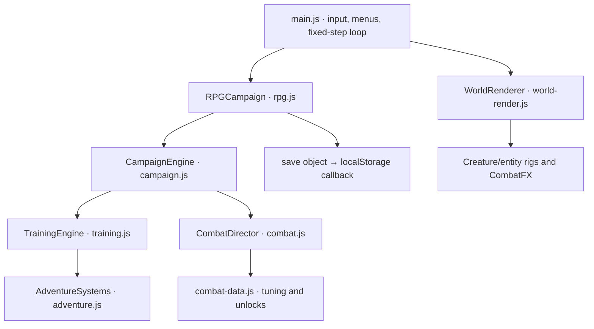

# Architecture

[Documentation index](README.md) · [Project README](../README.md)

## Runtime and build

The game is a static Canvas2D application written in JavaScript ES modules with plain HTML and CSS. esbuild bundles src/main.js and its imports into a checked-in classic IIFE script, bundle/game.js. index.html loads that deferred script, supporting direct-file use and hosting under a repository subpath without module fetches. Fonts and icons are local.

Node provides development, build, verification, and a simple static HTTP server. There is no gameplay backend, account service, database, or runtime package dependency. Playwright is a development dependency for Chromium integration.

## Engine layers

AdventureSystems owns party resources, healing, signature skills, statuses, and the original minions. TrainingEngine supplies the shared motion, collision, strike, and projectile kernel; its old six-chamber training route remains an isolated regression fixture, not a selectable game mode. CampaignEngine replaces those lesson gates with rooms, guardians, traversal, interaction, crafting, and persistent progression. RPGCampaign adds quests, gear, talents, covenants, mastery, events, optional bosses, and save migration.

CombatDirector is composed into CampaignEngine rather than another inheritance layer. It owns attack states, buffered routes, cancels, Guard/parry, Flow, posture, juggling, and equipped arts. It calls the host engine’s strike/reward path so RPG modifiers and quest attribution remain intact. Party signatures remain in the shared/campaign skill implementations.

## Simulation and presentation

main.js advances gameplay at a fixed 60 Hz using a requestAnimationFrame accumulator, with bounded catch-up steps. Gameplay frames determine attacks, timers, and collision. Hitstop preserves combat windows. Canvas rendering uses a separate presentation clock for interpolation-like motion, breathing, and particles; effects cannot generate damage.

Positions are world pixels with positive Y downward. Player and enemy positions refer to their feet; common ground is Y = 520. The actor has one world transform across party swaps, while health, Focus, and signature cooldowns belong to the selected party member. Shared Guard, movement expenditure, and art cooldowns prevent swap-refresh exploits.

WorldRenderer follows the player with a camera, then draws biome layers, geometry, room objects, entities, actor, projectiles, hazards, and effects. CombatFX uses bounded pools and seconds-based visual lifetimes. Its camera zoom is an **absolute multiplier**: 1 is neutral. Reduced motion disables camera impulses and softens flashes. Creature rigs use simulation attack progress for anticipation/contact/recovery. Entity wrappers preserve Canvas context state around existing art.

The UI uses one dialog for menus, dialogue, rewards, and endings. Opening it pauses gameplay and clears held inputs. Blur and tab hiding also pause through the UI. window.kinetic exposes a defensive snapshot and version for inspection, not a mutable game object or a cheat API.

## Source map

| File | Responsibility |
| --- | --- |
| [src/rpg.js](../src/rpg.js) | RPG quests, equipment, talents, factions, mastery, world events, v2/v3/v4 save migration |
| [src/combat.js](../src/combat.js) | Frame-driven attack controller, movement cancels, Guard/parry, juggle/posture, powers |
| [src/combat-data.js](../src/combat-data.js) | Move frame data, movement tuning, twelve art definitions and unlock rules |
| [src/combat-fx.js](../src/combat-fx.js) | Capped particles, biome ambience, elemental impacts, camera and screen feedback |
| [src/entity-animation.js](../src/entity-animation.js) | Boss/minion action, recoil/death, telegraphs and NPC interaction animation |
| [src/combat-ui.js](../src/combat-ui.js), [src/combat-style.css](../src/combat-style.css) | Responsive Arsenal, move manual, power loadout and combat HUD |
| [src/chronicle.js](../src/chronicle.js) | Eight optional story arcs, covenants, new rooms/bosses/entities, ten history records |
| [src/rpg-data.js](../src/rpg-data.js) | Talent trees, equipment modifiers, item rarities, merchant stock, bond ranks |
| [src/rpg-ui.js](../src/rpg-ui.js) | Quest journal, talent constellation, reliquary, soul bonds, history, covenants, merchant |
| [src/chronicle-art.js](../src/chronicle-art.js) | Animated original forbidden bosses, new minion rigs, world events |
| [src/rpg-render.js](../src/rpg-render.js) | New NPC rigs, room landmarks, mastery auras, loot and the familiar |
| [src/rpg-world.js](../src/rpg-world.js) | Additive campaign registry integration with stable original save identifiers |
| [src/world.js](../src/world.js) | Campaign graph, geometry, biomes, story, guardians, items, charms, ability rewards |
| [src/campaign.js](../src/campaign.js) | Room state, progression, saves, fast combat, tools, crafting, recruitment, guardian AI |
| [src/training.js](../src/training.js) | Shared locomotion/collision implementation and isolated regression fixture |
| [src/adventure.js](../src/adventure.js) | Independent party resources, healing, original skills, statuses, minion AI |
| [src/designs.js](../src/designs.js) | Supplied creature identities, new companions, wild species |
| [src/creatures.js](../src/creatures.js) | Original vector rigs and procedural animation |
| [src/world-render.js](../src/world-render.js) | Parallax biome scenery, structures, unique guardian rigs, effects, camera |
| [src/main.js](../src/main.js) | Campaign UI, dialogs, atlas, inventory, keyboard/touch controls, fixed-step loop |
| [src/render.js](../src/render.js) | Shared canvas sizing and portraits |
| [src/style.css](../src/style.css) | Responsive interface and locally bundled fonts |

| Tooling / entry | Responsibility |
| --- | --- |
| [src/mobile.css](../src/mobile.css) | Landscape thumb controls, rotation prompt and priority menu |
| [index.html](../index.html) | Home, Canvas, HUD, touch controls, shared dialog |
| [server.mjs](../server.mjs) | Static HTTP serving and local MIME types |
| [scripts/build.mjs](../scripts/build.mjs) | esbuild bundle, watch mode, bundle comparison |
| [scripts/check.mjs](../scripts/check.mjs) | Syntax checks and generated-bundle freshness |
| [tests/](../tests/) | Simulation tests, route controllers, Chromium suites |

## Mobile layout ownership

main.js detects coarse-pointer devices and compact viewports, activates the mobile-game layout, and pauses active gameplay in portrait. The rotate prompt makes the game and any existing modal inert; returning to landscape restores the previous modal pause state. Resize transitions clear held actions. Fullscreen/orientation locking is attempted only from the explicit landscape button; manual rotation remains the fallback. src/mobile.css lays out larger combat/movement targets and the priority menu. The viewport remains unrotated so input coordinates, dialogs, and screen readers share the same coordinate space.

## Data registration and extension boundaries

world.js defines the main registries. chronicle.js remains pure optional-story data; importing rpg-world.js merges optional rooms, enemies, bosses, links, and dialogue into the main registries. Import the RPG entry when inspecting the complete live world; world.js alone contains only the base campaign.

Persistent identifiers belong to content definitions and must remain stable across releases. Keep render code free of save mutations and collision logic. Use engine events for effects and notifications. Update data, gameplay behavior, art, menu descriptions, and meaningful tests together when adding a mechanic. See [content authoring](content-authoring.md) and [save format](save-format.md).
