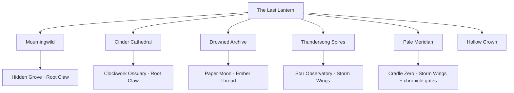

# World and story

[Documentation index](README.md) · [Project README](../README.md)

## Campaign map

There are **18 rooms, six biomes, nine bosses, 11 companions, and 15 wild species**. The original eight companions are available from the start. Three new companions join after their guardians are freed.

| Region | Places | Guardian | Ability / rescue |
| --- | --- | --- | --- |
| Sanctuary | The Last Lantern | — | Professor Vell, six portals, workbench, waylight |
| Mourningwild | The Rootway, Matron’s Bower, Hidden Grove | Briar Matron | Root Claw wall jump; Mycora |
| Cinder Cathedral | Pilgrim’s Furnace, Bellows Altar | Saint Bellows | Ember Thread grapple |
| Drowned Archive | Sunken Stacks, Ink Chamber | Ink Leviathan | Tideglass Seal; Lumivern |
| Thundersong Spires | Bellwind Crossing, Conductor’s Roost, Fallen Star Observatory | Storm Conductor | Storm Wings double jump |
| Pale Meridian | Stillwood, Last Second | Hourglass Stag | Rift Step; Chronowl |
| Hollow Crown | Unwritten Road, Heart Below | Hollow Sovereign | Final memory and two endings |

The sanctuary connects the chapters. Each restored fragment opens another portal. Region paths and guardian rooms connect in both directions; the hidden branches reward returning after new abilities awaken. The atlas records discoveries and offers fast travel from a safe waylight to a discovered room.

Traversal includes a lever-operated rootbridge, wall climbing, furnace gaps, grapple crossings, moving sky platforms, a high frozen ascent, and a physical violet veil that only an awakened dash can cross. Benches, the workbench, story inscriptions, travelers, material caches, ore veins, and hidden shrines all have interactions.

Room counts include the sanctuary and five optional rooms. The six biome count excludes the sanctuary palette.

The hub portals unlock in chapter order through the six main fragments. Optional guardians use a separate defeated-boss set; defeating them cannot skip main portal gates. The atlas shows discovered destinations. Fast travel requires a nearby waylight on the same ground, a destination with a waylight, and no nearby living threat.

## Optional chronicle

The sanctuary has seen ninety-nine expeditions. Iona’s living map knows every traveler. It does not know you. Investigate a century of unfinished promises through **eight quest lines**, four new story characters, ten gradually revealed history records, and three optional dungeons. Read inscriptions with E, speak to the quest giver to accept and turn in objectives, and pin a story in **N → Chronicles**. Completed field notes can be reread in World History. The original six-fragment campaign remains intact; optional bosses do not open main portals early.

- **The Clockwork Ossuary** branches from Pilgrim’s Furnace. Captain Cairn’s garden-filled armor shelters a borrowed dawn. Face **the Saint of Two Dawns**, a bronze saint with two masks and chained bells.
- **The Paper Moon** branches from the Sunken Stacks. Morrow Nine listens to voices trapped in living correspondence. Face **the Palimpsest**, a many-handed living book that eats the end of every goodbye.
- **Cradle Zero** branches from the Stillwood. Pip carries an egg with no remembered creature inside. The **Nullheart** awakens after both other forbidden guardians, the Hollow Sovereign, and a sworn covenant. Its attack pattern and narrative identity change with your oath.

Choose among the Lantern Compact (+1 party heart), the Drowned Choir (+20% Focus on direct hits), and the Unwritten (shorter dash recovery). The oath is permanent for that expedition. Each offers a different answer to the Worldheart’s fate; completing its stories improves its epilogue. The true endings follow the optional arc, beyond the original two main-campaign endings. Completing Pip’s story lets you carry the blank egg; after the true ending it hatches into a small familiar that assists nearby fights.

Cradle Zero also requires victories over Belltwin and Palimpsest and a sworn covenant to enter through its branch. The Nullheart stays sealed until the Hollow Sovereign has also been defeated. Each optional dungeon has its own waylight, inscriptions, travelers, rewards, and a return route.

The eight quest definitions, prerequisites, objectives, and rewards live in [chronicle.js](../src/chronicle.js). The three optional guardians are registered through [rpg-world.js](../src/rpg-world.js), while their combat behavior lives in [rpg.js](../src/rpg.js).

## Covenant effects

| Save ID | Covenant | Implemented benefit |
| --- | --- | --- |
| `wardens` | The Lantern Compact | +1 maximum heart to each party member |
| `chorus` | The Drowned Choir | Extra Focus on direct hits |
| `unwritten` | The Unwritten | Dash cooldown reduced by three frames |

The oath cannot be replaced during the expedition. It changes the optional final guardian’s identity and attack behavior and determines the true-ending branch. Quest completion adds context to that epilogue.

<strong>Major story spoilers: Vell, the Worldheart, and the endings</strong>

The Worldheart is a living creature, not a machine. A century ago, Vell opened its cage; the original Professor died entering the containment breach. The Vell at the Last Lantern is an echo kept alive through memory, spending those memories to sustain the waylights.

The player is the first new life the Worldheart has created, rather than another remembered expedition. Iona’s map cannot recognize a traveler who has never existed before. Cairn, Morrow, and Pip’s stories gradually reveal why repetition, preservation, and freedom mean different things to the surviving echoes.

The original main-campaign choices are `restore` and `release`. The optional arc continues beyond them: restore the forbidden memories, swear a covenant, and confront the Nullheart. Its covenant-dependent identities include Vell, the Perfect Memory, the First Chorus, and the Unwritten Heir. Three true endings follow the three oaths.

Completing Pip’s story awards the blank egg keepsake. After the true ending, it hatches into a small familiar that assists nearby fights. The completed world remains available for exploration and unfinished stories.

## Narrative conventions for new content

Keep major revelations behind earned quest or history gates. Reward guardians with memories and consequences rather than generic victory text. Preserve the distinction between main fragments, optional guardians, and personal quest rewards. See [content authoring](content-authoring.md) before changing progression identifiers.
