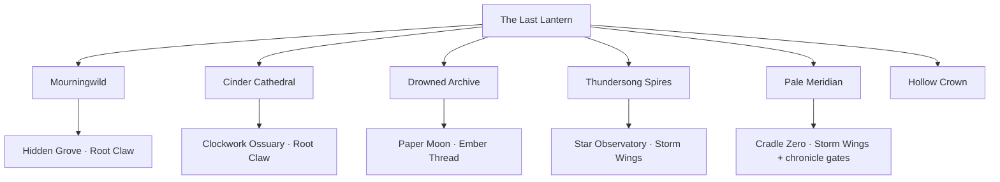

# World and story

[Documentation index](README.md) · [Project README](../README.md)

## Campaign map

There are **42 rooms, six dimensions, nine major bosses, twelve minibosses, 11 companions, and 19 wild species**. The original eight companions are available from the start. Three new companions join after their guardians are freed.

| Region | Places | Guardian | Ability / rescue |
| --- | --- | --- | --- |
| Sanctuary | The Last Lantern | — | Professor Vell, six portals, workbench, reusable recovery hearth |
| Mourningwild | The Rootway, Matron’s Bower, Hidden Grove | Briar Matron | Root Claw wall jump; Mycora |
| Cinder Cathedral | Pilgrim’s Furnace, Bellows Altar | Saint Bellows | Ember Thread grapple |
| Drowned Archive | Sunken Stacks, Ink Chamber | Ink Leviathan | Tideglass Seal; Lumivern |
| Thundersong Spires | Bellwind Crossing, Conductor’s Roost, Fallen Star Observatory | Storm Conductor | Storm Wings double jump |
| Pale Meridian | Stillwood, Last Second | Hourglass Stag | Rift Step; Chronowl |
| Hollow Crown | Unwritten Road, Heart Below | Hollow Sovereign | Final memory and two endings |

The sanctuary connects the chapters. Each restored fragment opens another portal. Each gate road leads through a grounded lower dungeon passage and a warden court before its guardian. High passages and vaults branch from these chambers and reconnect through shortcuts; the original hidden branches reward returning after new abilities awaken. The atlas records discovered passages, recovery springs, and utility camps. Activated springs and camps support fast travel without a health refill.

The main roads and dungeon passages have continuous lower floors. The rootbridge lever, upper wall routes, grapple anchors, moving shelves, and high frozen balconies remain exploration features, while the physical violet veil still requires an awakened dash. Optional climbs have wider ledges and catch shelves rather than long lethal drop spans. Camps, the workbench, story inscriptions, travelers, material caches, ore veins, and hidden shrines all have interactions. Wellsprings activate automatically when entered.

Room counts include the sanctuary, 12 original main-route rooms, 24 new dungeon chambers, and the five original optional rooms. Each gate contains two or three seeded Wellsprings in its interior chambers; the sanctuary also has a reusable hearth. Former benches are utility camps rather than healing points. The six biome count excludes the sanctuary palette.

The hub portals unlock in chapter order through the six main fragments. Optional guardians use a separate defeated-boss set; defeating them cannot skip main portal gates. The atlas shows discovered destinations. Fast travel requires a nearby service point on the same ground, a discovered destination camp or activated spring, and no nearby living threat. It does not heal the party or bind a new respawn spring.

## Hearing the levels

Story voices belong to places and creatures. Every room has a brief authored whisper at an existing landmark: roots remember a promise in the Mourningwild, furnace records count borrowed dawns, drowned shelves hold missing names, storm bells leave space for a ninth voice, frozen hours shelter unfinished tomorrows, and the Crown remembers its first cage. These lines appear in the scene when you approach during a quiet moment. They fade without stopping exploration or replacing the full field notes recorded in World History.

Travelers speak beside their own figures. E/Enter or the Continue touch button advances their conversation; moving away leaves it. The 21 bosses each have their own arrival and defeat words tied to their encounter. Authored whispers and boss lines supply local context; major revelations still follow earned NPC quests, history records, and ending choices.

The six fragment guardians and three forbidden guardians have short chamber introductions before combat. The main ending choice and the optional final covenant each lead into a party-centered finale. These scenes can be skipped and do not change a saved decision or the requirements for reaching an ending.

## Optional chronicle

The sanctuary has seen ninety-nine expeditions. Iona’s living map knows every traveler. It does not know you. Investigate a century of unfinished promises through **eight quest lines**, four new story characters, ten gradually revealed history records, and three optional dungeons. Read inscriptions with E, speak to the quest giver to accept and turn in objectives, and pin a story in **N → Chronicles**. Completed field notes can be reread in World History. The six-fragment progression remains intact; optional bosses and dimensional minibosses do not open main portals early.

- **The Clockwork Ossuary** branches from Pilgrim’s Furnace. Captain Cairn’s garden-filled armor shelters a borrowed dawn. Face **the Saint of Two Dawns**, a bronze saint with two masks and chained bells.
- **The Paper Moon** branches from the Sunken Stacks. Morrow Nine listens to voices trapped in living correspondence. Face **the Palimpsest**, a many-handed living book that eats the end of every goodbye.
- **Cradle Zero** branches from the Stillwood. Pip carries an egg with no remembered creature inside. The **Nullheart** awakens after both other forbidden guardians, the Hollow Sovereign, and a sworn covenant. Its attack pattern and narrative identity change with your oath.

Choose among the Lantern Compact (+1 party heart), the Drowned Choir (+20% Focus on direct hits), and the Unwritten (shorter dash recovery). The oath is permanent for that expedition. Each offers a different answer to the Worldheart’s fate; completing its stories improves its epilogue. The true endings follow the optional arc, beyond the original two main-campaign endings. Completing Pip’s story lets you carry the blank egg; after the true ending it hatches into a small familiar that assists nearby fights.

Cradle Zero also requires victories over Belltwin and Palimpsest and a sworn covenant to enter through its branch. The Nullheart stays sealed until the Hollow Sovereign has also been defeated. Each optional dungeon has a utility camp, inscriptions, travelers, rewards, and a return route. Recovery springs are budgeted across the whole gate rather than guaranteed at each dungeon entrance.

The eight quest definitions, prerequisites, objectives, and rewards live in [chronicle.js](../src/chronicle.js). The three optional guardians are registered through [rpg-world.js](../src/rpg-world.js), while their combat behavior lives in [rpg.js](../src/rpg.js).

## Covenant effects

| Save ID | Covenant | Implemented benefit |
| --- | --- | --- |
| `wardens` | The Lantern Compact | +1 maximum heart to each party member |
| `chorus` | The Drowned Choir | Extra Focus on direct hits |
| `unwritten` | The Unwritten | Dash cooldown reduced by three frames |

The oath cannot be replaced during the expedition. It changes the optional final guardian’s identity and attack behavior and determines the true-ending branch. Quest completion adds context to that epilogue.

<strong>Major story spoilers: Vell, the Worldheart, and the endings</strong>

The Worldheart is a living creature, not a machine. A century ago, Vell opened its cage; the original Professor died entering the containment breach. The Vell at the Last Lantern is an echo kept alive through memory, spending those memories to sustain the waylights.

The player is the first new life the Worldheart has created, rather than another remembered expedition. Iona’s map cannot recognize a traveler who has never existed before. Cairn, Morrow, and Pip’s stories gradually reveal why repetition, preservation, and freedom mean different things to the surviving echoes.

The original main-campaign choices are `restore` and `release`. The optional arc continues beyond them: restore the forbidden memories, swear a covenant, and confront the Nullheart. Its covenant-dependent identities include Vell, the Perfect Memory, the First Chorus, and the Unwritten Heir. Three true endings follow the three oaths.

Completing Pip’s story awards the blank egg keepsake. After the true ending, it hatches into a small familiar that assists nearby fights. The completed world remains available for exploration and unfinished stories.

## Narrative conventions for new content

Keep major revelations behind earned quest or history gates. Reward guardians with memories and consequences rather than generic victory text. Preserve the distinction between main fragments, optional guardians, and personal quest rewards. See [content authoring](content-authoring.md) before changing progression identifiers.

## The six buried histories

Each dimension has four deeper chambers: a lower tunnel passage, a warden court, an abandoned high road, and a forbidden vault. The lower passage reaches its court through a ground-level exit; its preserved upper shelves lead to optional discoveries and loops. The court warden must fall before the guardian seal opens. Vault reavers are optional; their hoards and return passages stay sealed until victory. See [dimensions.js](../src/dimensions.js) for all 24 chambers and their inscriptions, and [dungeon-enemies.js](../src/dungeon-enemies.js) for the twelve wardens and reavers.

| Region | Dungeon | Deeper chambers |
| --- | --- | --- |
| Mourningwild | The Root Beneath the Root | Rootfall Cistern; The Grafted Court; Canopy of Unborn Seeds; The Sap Widow’s Reliquary |
| Cinder Cathedral | The Furnace Below the Bells | The Ashen Switchworks; Court of the Last Censer; The Unrung Belfry; The Furnace of Small Suns |
| Drowned Archive | The Archive Beneath the Sea | The Flooded Index; The Unreturned Court; The Inverted Reading Room; The Cabinet of Stolen Names |
| Thundersong Spires | The Choir Above the Storm | The Broken Bellwind; Court of the Thunder Choir; The Breathless Spire; The Vault of the Ninth Voice |
| Pale Meridian | The Winter Inside a Second | The Fractured Second; Court of the Rimekeeper; The Stair of Unspent Hours; The Vault of Borrowed Tomorrows |
| Hollow Crown | The Cage Beneath the Crown | The Wound Between Worlds; Court of the Empty Throne; The Stair That Remembers You; The Vault of the First Cage |

| Dimension | Buried story | Traversal |
| --- | --- | --- |
| Mourningwild | The forest’s protectors were chained to the roots they saved | Grounded root tunnels with optional upper switchbacks |
| Cinder Cathedral | The council burned memories as fuel and called it salvation | Solid furnace corridors, wall routes, and optional high ledges |
| Drowned Archive | Missing names belong to people removed from history | Lower archive tunnels and upper grapple-linked stacks |
| Thundersong | The sky broke trying to contain the voices the choir silenced | Grounded storm passages with optional moving shelves |
| Pale Meridian | A stolen tomorrow waits inside the second that never ended | Continuous frozen floor with optional double-jump climbs |
| Hollow Crown | The first cage held the creature that would become your family | Lower basalt tunnels, optional high routes, and vault loops |

The atlas shows room connections as you discover them, with depth labels and current position. Wellspring markers distinguish unused and spent recovery points, and camp markers identify utility services. Discovering an ordinary room does not enable fast travel there. The prototype expands exploration substantially; its scale remains smaller than a full commercial metroidvania.

## Tunnel presentation and gate death

The first gate’s upper passages now form connected landing networks rather than a single staircase. Parallel climbs meet at broad mezzanines, with crossways, pocket balconies, and lower galleries beneath the jumps. A missed jump can land on another playable tier, from which the player can climb back into the route. The lower tunnel remains continuously grounded. These routes are authored in [moss-layout.js](../src/moss-layout.js); the Rootfall branches work with the first gate’s starting movement abilities.

Outside the sanctuary, chambers are enclosed by layered rock walls, irregular ceilings, arches, and textured shelves attached to receding stone strata. Roots, volcanic masonry, flooded limestone, storm ruins, ice, and rift basalt give the six dimensions distinct geology. Foreground detail and local light preserve readable collision edges. Continuous lower floors and catch shelves now support the tunnel routes; the shared jump, dash, and combat physics are unchanged.

A party wipe reawakens the enemies throughout the current dimension, including the gate’s minibosses and guardians. Your recovered story fragments and abilities remain unlocked, and repeated victories do not duplicate unique loot or first-victory rewards. The Game Over screen shows the penalty before you retry from the last activated spring.
